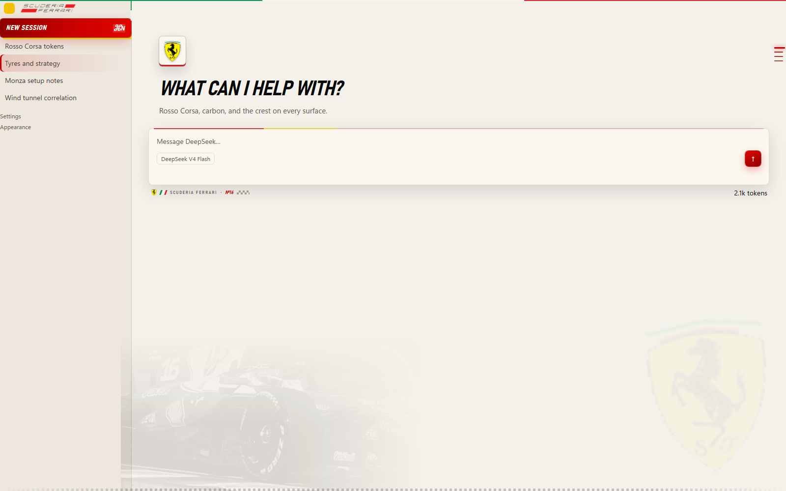

# F1 Forza Ferrari theme for DeepSeek Harness

A client-only Web UI theme built from the Scuderia Ferrari artwork and the SF-25
reference shot: Rosso Corsa and carbon, the supplied crest and wordmark, a
tricolore rule along the window top, a ghost of the car in the canvas, and a
finish line along the floor. Light mode is race-day white; dark mode is the
garage at night. The host half is intentionally empty.



## What it changes

- **Both palettes, complete.** Every alias token is supplied for Light and Dark,
  so switching schemes never leaves a stale colour behind.
- **The supplied artwork, applied four ways.** The crest is cropped out of the
  provided logo (red swoosh removed, transparency preserved) and embedded as a
  data URI for the rail mark, the empty-state plate, and the pit-wall decal. The
  wordmark is embedded twice — original and a warm-white recolour — and swapped
  by scheme via `--f1-wordmark`, so it reads on paper and on carbon without a
  plate behind it.
- **Empty-state race plate.** The blank-session mark slot renders the crest at the
  34 px edge the host asks for; the host's own `fishHitbox` wrapper is dressed as
  a cream cartouche with a tricolore cap and a red sill.
- **Canvas artwork.** The car is a grayscale ghost feathered into the bottom-left
  of the conversation column (`multiply` on paper, inverted at low alpha on
  carbon). The crest bleeds faintly out of the bottom-right corner. A 5 px
  checkered finish line runs along the window floor.
- **Tricolore ribbon.** A 2 px green/white/red rule pinned across the top of the
  conversation column, starting at the rail's edge.
- **Start-light switch.** A five-lamp gantry in the session header utilities
  replaces the usual sun/moon: lamps are lit in the dark scheme and dim in the
  light one, and clicking it writes a normal Light/Dark preference.
- **Rosso Corsa chrome.** The New Session button is a red gradient with a yellow
  offset shadow, italic condensed type, and a pressed state. Send is a red plate
  that lifts on hover. Selected sidebar rows get a red rail and wash; the turn
  outline fades red-to-grey by distance from the active turn.
- **Composer.** A carbon plate with a red-to-yellow speed rule along its leading
  edge, a red hairline on focus, and a pit-wall decal in the dock row: crest,
  tricolore bars, `SCUDERIA FERRARI`, `№16`, and a small finish flag.
- **Type and shape.** Bahnschrift SemiCondensed for display text, tighter radii
  (2/5/8/12/16/20), red focus rings, red scrollbars and text selection.

## Install

From the DSH Web GUI: **Plugins → Add plugin → local directory path**, then enter
this directory and choose **Install → Enable now**.

The bundle also works through `plugin_manager` with `action: install_bundle` and
this directory as the `target`.

Only one theme should be enabled at a time: themes are override layers over the
same tokens, so a second enabled theme will fight this one for the palette.

## Build

`client.js` is generated — edit `client.template.js`, then:

```powershell
python assets/build_assets.py     # crops the crest + wordmark, recolours, ghosts the car
node tools/inline-assets.mjs      # inlines the bitmaps into client.js and icon.svg
node tools/preview.mjs            # optional: writes preview/mock-*.html for a static look
```

`assets/build_assets.py` reads `assets/source-logo.png` and `assets/source-car.jpg`
(the supplied files) and writes `shield.png`, `lockup.png`, `lockup-dark.png`, and
`car-ghost.webp`. Everything downstream reads the `.b64` copies.

## Files

| File | Role |
|---|---|
| `index.js` | Host half; empty plugin row that keeps the bundle active. |
| `client.js` | Generated client half: tokens, stylesheet, artwork, slots. |
| `client.template.js` | Source of `client.js`; the file to edit. |
| `cordis.patch.yml` | Bundle patch that inserts the `forza-ferrari-theme` row. |
| `icon.svg` | Plugin Manager artwork: the crest on a carbon tile. |
| `locale/*.json` | Plugin Manager title and description. |
| `assets/` | Supplied artwork, the crop/recolour script, and base64 payloads. |
| `tools/` | Build and preview scripts. Not part of the runtime. |
| `preview/` | Scratch renders used to review the theme. Not part of the runtime. |

## Notes

The theme is an override layer, not a new preference value, so the built-in
Light/Dark/System choice keeps working. Removing or disabling the bundle restores
the host palette, removes the stylesheet and the artwork layer, and returns both
brand slots to the stock content.

The stylesheet reaches the host chrome through class fragments
(`[class*="sidebarCol"]`, `[data-composer-card]`, `[class*="fishHitbox"]`,
`[class*="newSession"]`) plus the documented slot contracts
(`sidebar.brand.mark`, `sidebar.brand.name`, `conversation.hero.brand.mark`,
`conversation.composer.dock`, `conversation.session.header.utilities`). If a
future build renames one of those hooks, only that flourish disappears; the
palette, the artwork layer, and the slots keep working.
